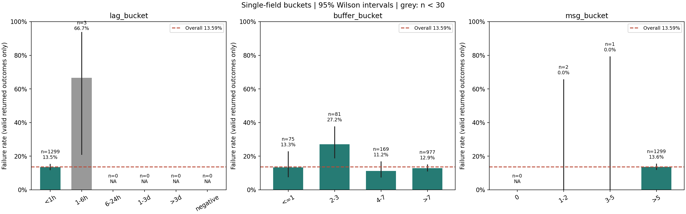
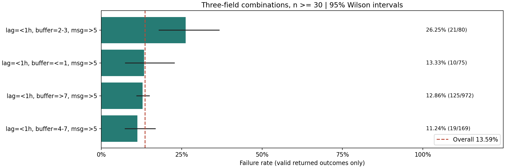
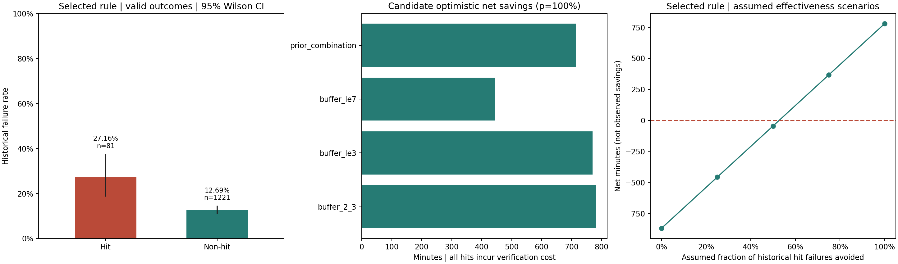

# 慢病干预失效分析

目标是减少健康管理师在患者状态尚未核实时进行无效随访。本项目仅使用题目发放的 [interventions.csv](interventions.csv)，完成数据审计、风险关联分析和提前转人工核验候选设计。当前交付是可复现的离线分析，不是已上线系统或因果效果证明。

## 我的判断

### 看到了什么

| 观察 | 数据证据 | 来源 |
| --- | --- | --- |
| 存在明确的历史干预失效 | 原始数据 1,350 行、8 列；遵从 1,125 条，失效 177 条，未回传 48 条 | [reports/01_audit.md](reports/01_audit.md) |
| 未回传不能算失效 | 有效回传 1,302 条，失效率为 177 / 1,302 = 13.59%；未回传率 3.56% | [reports/01_audit.md](reports/01_audit.md) |
| 原始记录存在重复加权风险 | 完全重复行 64 条（不含首次），重复业务编号涉及 128 行 | [reports/01_audit.md](reports/01_audit.md) |
| 缓冲天数存在值得验证的信号 | 缓冲天数 2–3 天桶的失效率为 22 / 81 = 27.16%，但风险并非随天数单调变化 | [reports/02_rootcause.md](reports/02_rootcause.md) |
| 指定延迟桶不能支持强结论 | 延迟最大为 1 小时；1–6 小时桶仅有 3 条有效回传，其他更长延迟桶没有记录，样本不足，不能下结论 | [reports/01_audit.md](reports/01_audit.md)、[reports/02_rootcause.md](reports/02_rootcause.md) |
| 消息量缺乏足够的跨桶比较 | `>5` 桶有 1,299 条有效回传；其余有样本桶分别只有 2 条和 1 条，样本不足，不能下结论 | [reports/02_rootcause.md](reports/02_rootcause.md) |

### 根问题是什么

业务上的待验证问题是：任务生成时可见的患者状态，是否足够支持管理师直接执行原随访建议。现有数据没有记录患者自行调整方案的原因、人工核验动作或投诉明细，不能确认“信息脱节导致失效”的因果链。

我选择先解决可操作的问题：用任务生成时可见的缓冲天数识别一批值得提前核验的记录，再以试点确认核验是否有效。结果回传不完整和业务记录重复也必须先核实，避免把数据质量问题误判成患者风险。

## 做了什么

- **数据审计**：检查结构、缺失、非法值、重复记录和字段分布；带时区时间统一为 UTC，按总秒数计算 `data_lag_hours`；负延迟单列而不直接删除。见 [reports/01_audit.md](reports/01_audit.md) 和 [reports/01_distributions.csv](reports/01_distributions.csv)。
- **风险关联分析**：按指定延迟、缓冲天数和消息量分桶，计算单字段与交叉组合失效率，并比较完全重复行去重后的结果。有效回传数低于 30 的组合标注“样本不足，不能下结论”。来源：[reports/02_rootcause.md](reports/02_rootcause.md)。
- **简单规则比较**：比较缓冲天数区间、更宽的阈值及先前的交叉组合，并列出全转人工和不新增转人工的成本参照。按样本内乐观净节省选择候选，不训练复杂模型。见 [reports/03_rule.md](reports/03_rule.md)。
- **完整保留分析过程**：所有计算集中在 [scripts/analyze.py](scripts/analyze.py)，AI 提示词、口径约束、人工测试输入边界和修订过程记录在 [AI_LOG.md](AI_LOG.md)。

### 候选规则

**任务生成时，若 `2 <= buffer_days <= 3`，提前转人工核验；否则保持既有随访流程。** 规则及阈值来源：[reports/03_rule.md](reports/03_rule.md)。

核验内容为当前用药与生活方式方案、近期健康数据，以及患者是否自行调整方案。规则不自动改变治疗；未命中不等于安全，不能延迟既有高危处置。缓冲天数缺失时不自动命中，单独进入数据质量检查。

规则输入白名单为 `created_at`、`device_synced_at`、`center_id`、`plan_type`、`buffer_days`、`msg_count`；最终候选只使用 `buffer_days`。`result_ok` 只作离线结果标签，业务编号也不进入规则函数。

## 怎么证明有用

### 离线风险识别价值

以下证明的是候选在历史样本中能够集中识别部分失效记录，不代表人工核验已经改善结果。每项指标来源均为 [reports/03_rule.md](reports/03_rule.md)，可对照 [reports/03_rule_candidates.csv](reports/03_rule_candidates.csv)。

| 指标 | 结果 | 来源 |
| --- | --- | --- |
| 命中数，含未回传 | 87 条 | [reports/03_rule.md](reports/03_rule.md) |
| 命中有效回传 / 历史失效 / 未回传 | 81 / 22 / 6 条 | [reports/03_rule.md](reports/03_rule.md) |
| 命中失效率 | 22 / 81 = 27.16% | [reports/03_rule.md](reports/03_rule.md) |
| 未命中数 / 有效回传 / 历史失效 | 1,263 / 1,221 / 155 条 | [reports/03_rule.md](reports/03_rule.md) |
| 未命中失效率 | 155 / 1,221 = 12.69% | [reports/03_rule.md](reports/03_rule.md) |
| 提升倍数，命中失效率除以未命中失效率 | 2.140 倍；用未四舍五入的比例计算 | [reports/03_rule.md](reports/03_rule.md) |
| 规则去重后表现 | 命中 84 条，有效回传 78 条，历史失效 22 条；命中失效率 28.21%，对未命中提升 2.228 倍 | [reports/03_rule.md](reports/03_rule.md) |

根因阶段的最高达标交叉组合为“延迟 <1 小时、缓冲天数 2–3 天、消息量 >5”，失效率 21 / 80 = 26.25%；最终单字段候选覆盖更宽且条件更少。两者不是同一条规则，不混用统计数字。来源：[reports/02_rootcause.md](reports/02_rootcause.md)、[reports/03_rule.md](reports/03_rule.md)。



图表来源：[reports/02_rootcause.md](reports/02_rootcause.md)。灰色表示样本不足，NA 表示无有效分母；置信区间不证明因果关系。



图表来源：[reports/02_rootcause.md](reports/02_rootcause.md)。组合按有效回传样本门槛筛选，不把空桶视为低风险。

### 成本收益测算，不是已实现收益

题目口径为每次失效约损失 75 分钟、每次提前核验约花费 10 分钟；业务假设来自 [任务书.md](任务书.md)，下列计算来源为 [reports/03_rule.md](reports/03_rule.md)。

$$
\text{乐观净节省分钟} = 22 \times 75 - 87 \times 10 = 780
$$

该公式假设命中中的全部历史失效都能避免；命中未回传不当作失效，但仍计核验成本。数字及口径来源：[reports/03_rule.md](reports/03_rule.md)。

| 假设的命中历史失效避免比例 | 情景净节省分钟 | 来源 |
| --- | --- | --- |
| 0% | -870 | [reports/03_rule_effectiveness.csv](reports/03_rule_effectiveness.csv) |
| 25% | -457.5 | [reports/03_rule_effectiveness.csv](reports/03_rule_effectiveness.csv) |
| 50% | -45 | [reports/03_rule_effectiveness.csv](reports/03_rule_effectiveness.csv) |
| 75% | 367.5 | [reports/03_rule_effectiveness.csv](reports/03_rule_effectiveness.csv) |
| 100% | 780 | [reports/03_rule_effectiveness.csv](reports/03_rule_effectiveness.csv) |

盈亏平衡需要避免命中历史失效的 **52.73%**；当前没有测得这个效果，不能承诺节省。更宽的缓冲天数候选测算为 770 分钟，与所选候选的 780 分钟非常接近，不能把样本内排序当作统计优势。来源：[reports/03_rule.md](reports/03_rule.md)。



图表来源：[reports/03_rule.md](reports/03_rule.md)。右图是效果参数的假设情景，不是实际干预效果曲线。

下一步先影子运行，核实回传、任务去重和实际工作量；再以不影响既有高危处置的前瞻性对照试点，比较失效率、核验耗时、投诉及实际节约时间。

## 可复现步骤

在仓库根目录执行。已有成功运行环境为 Python 3.13.7、pandas 3.0.2，来源：[reports/01_audit.md](reports/01_audit.md)。下列命令固定已验证的 pandas 版本；matplotlib 未锁定版本，不保证跨环境图像逐像素一致。

```powershell
python -m venv .venv
.venv\Scripts\python.exe -m pip install "pandas==3.0.2" matplotlib
.venv\Scripts\python.exe scripts/analyze.py --stage audit
.venv\Scripts\python.exe scripts/analyze.py --stage rootcause
.venv\Scripts\python.exe scripts/analyze.py --stage rule
```

不需要激活虚拟环境，也不需要外部服务。已有依赖环境可直接运行对应的 `python scripts/analyze.py --stage ...`。不传 `--stage` 时仅运行审计；命令重建报告、明细和图表，不修改原始 CSV。脚本记录源文件哈希并检查输入未变化。

| 输出 | 内容 |
| --- | --- |
| [reports/01_audit.md](reports/01_audit.md)、[reports/01_distributions.csv](reports/01_distributions.csv) | 审计及全字段完整频数 |
| [reports/02_rootcause.md](reports/02_rootcause.md) | 分桶关联与局限 |
| [reports/02_lag_bucket.csv](reports/02_lag_bucket.csv)、[reports/02_buffer_bucket.csv](reports/02_buffer_bucket.csv)、[reports/02_msg_bucket.csv](reports/02_msg_bucket.csv) | 单字段分桶明细 |
| [reports/02_combinations.csv](reports/02_combinations.csv)、[reports/02_combinations_deduplicated.csv](reports/02_combinations_deduplicated.csv) | 全组合及去重敏感性明细 |
| [reports/03_rule.md](reports/03_rule.md)、[reports/03_rule_candidates.csv](reports/03_rule_candidates.csv) | 规则、候选比较及成本测算 |
| [reports/03_rule_sensitivity.csv](reports/03_rule_sensitivity.csv)、[reports/03_rule_effectiveness.csv](reports/03_rule_effectiveness.csv) | 去重、日期诊断与效果假设情景 |

此前已用标准库独立核对结果计数、全部时间差、分桶组合及规则指标，并测试结果字段拒绝、缺失标签和阈值边界；详情见 [AI_LOG.md](AI_LOG.md)。人工构造的输入仅用于内存测试，不进入业务统计。独立复核命令尚未整理为独立测试套件，当前脚本内保留计数守恒与源文件完整性检查。

## 局限

- **不是因果结论**：没有核验试验、患者自行调整原因或投诉明细；尚未控制中心、计划和日期等混杂。
- **不是独立验证**：候选设计、选择和评估共用已查看的数据；日期拆分只是事后诊断，不称为时间外验证。细节见 [reports/03_rule.md](reports/03_rule.md)。
- **缺失与重复**：未回传机制未知，不能将其填为失效或遵从；主结果按原始行计数，完全重复行仅做内存去重比较，业务编号唯一性仍待确认。
- **样本与覆盖不足**：有效回传数小于 30 的组合，样本不足，不能下结论；延迟和消息量缺乏足够达标桶，无法判断独立作用或外推空桶。门槛及证据来源：[reports/02_rootcause.md](reports/02_rootcause.md)。
- **不确定性未完全量化**：比例区间未校正候选选择、多重比较和重复观测；达到样本门槛不代表显著、稳定或可上线。
- **非临床决策**：候选只建议增加核验，不自动停药、改药或替代既有紧急处置；未命中患者仍须按原流程获得服务。
- **收益仍待验证**：核验的真实避免比例和实际工时尚未测量；只能给出基于题目成本口径的情景结果。

本轮完善内容为交付文档、数字来源导航及局限说明，未新增数据、重选规则或声称完成上线。AI 使用及实际修订记录见 [AI_LOG.md](AI_LOG.md)。