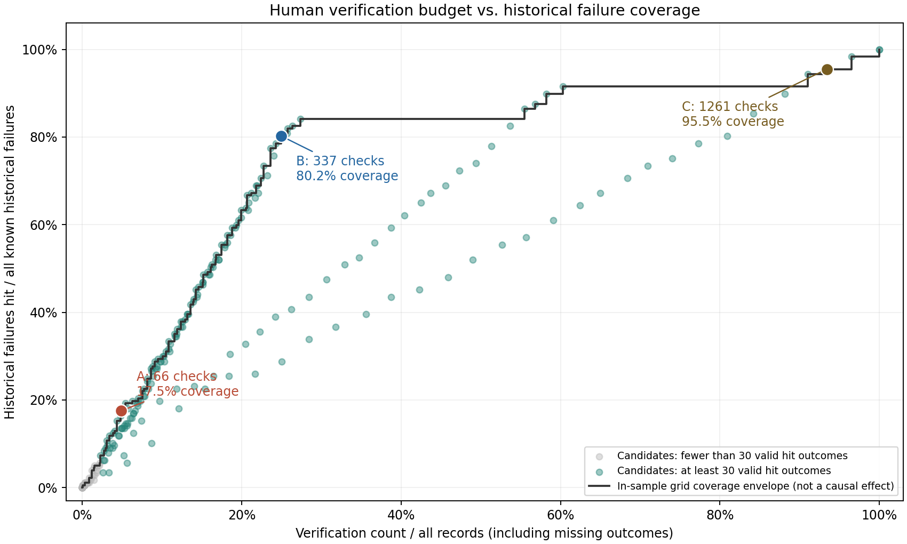

# 人工核验预算与历史失效覆盖权衡

## 1. 复现与假设

运行：`python scripts/analyze.py --stage budget_tradeoff`；依赖 pandas、matplotlib，唯一输入 interventions.csv。
环境：Python 3.13.7、pandas 3.0.2；源文件 SHA-256：`b1fe285a0e3cc56c2a71b705dca0098089baabb6ec86584b45e16859e4511ffb`。
主口径为原始 1350 行，其中有效回传 1302、已知失效 177、未回传 48、非法结果 0。保留重复行及所有结果空值，不填补。
规则函数只接收六个允许的干预前字段，result_ok 仅用于规则判断完成后的历史评估。负缓冲、负延迟或无法计算的特征不命中阈值规则，但仍保留在总体分母与单列计数中；全部核验参照包括所有记录。
| 阈值规则无法命中的数据质量标记（可重叠） | 记录数 |
| --- | --- |
| buffer_days 负值 | 0 |
| buffer_days 缺失/解析失败 | 0 |
| data_lag_hours 负值 | 0 |
| data_lag_hours 缺失/无法计算 | 0 |

核验量按全部命中记录计数，未回传也消耗人工；核验比例 = 命中量 / 总记录数。历史失效覆盖率 = 命中且 result_ok=0 / 全部 result_ok=0，与命中失效率不同。无已知失效时覆盖率为 NA，不能据此优选。
题目成本假设：每次核验 10 分钟，每次失效损失 75 分钟。设 p 为核验能真正避免命中历史失效的比例，净节省分钟 = p × 命中历史失效数 × 75 - 核验量 × 10。
p 未被当前数据测量；表中 p=50% 只是对比情景，不是效果估计，p=100% 是乐观上限，p=0 则只有新增成本。历史覆盖不等于已避免失效，也没有把未回传当失效或遵从。

## 2. 阈值遍历与选择口径

阈值族为 `0 <= buffer_days <= X AND data_lag_hours >= Y`。X 遍历 0 至 30 的全部整数天；Y 分钟遍历 0、5、10、15、20、30、45、60、120。边界均包含等号。
实际评估 279 种阈值组合；另含不新增核验、全部核验及原 buffer_2_3 规则参照，共 282 行，均见 06_budget_candidates.csv。相同命中集合的不同阈值仍保留，不能视为独立证据。
A/B 是规划用示例预算：总量的 5%/25%，向下取整；在不超预算且命中有效回传至少 30 的候选中优先最大化覆盖，相同覆盖取更少核验，仍相同按规则名确定性排序。若无达标候选则退回预算内方案并警示，绝不扩大预算。
若预算内筛选后的候选均未覆盖任何已知失效，则返回不新增核验参照，不为达到样本门槛而增加无历史覆盖收益的核验。
C 是覆盖优先：选择达到样本内至少 95% 历史失效覆盖的最少核验方案，同量时优先覆盖高者；可用全部核验参照兜底。95% 是规划目标，不是未来覆盖保证。没有已知失效则仅展示不新增核验参照。
B 表示预算内覆盖优先的折中展示，不等于经济最优。原 buffer_2_3 仅作参照，不参与新方案选优；本阶段不替换原规则，所选规则未必相互嵌套。

## 3. 三个典型方案

| 方案 | 定位 | 规则 | 预算上限/覆盖目标 | 核验量 | 核验比例 | 命中有效回传 | 命中失效 | 命中未回传 | 覆盖率 | 漏掉失效 | 命中失效率 | 核验工时（小时） | 净节省分钟 p=50%（假设） | 乐观净节省分钟 p=100% | 盈亏平衡 p | 样本说明 |
| --- | --- | --- | --- | --- | --- | --- | --- | --- | --- | --- | --- | --- | --- | --- | --- | --- |
| A | 极低预算 | 0 <= buffer_days <= 5 AND data_lag_hours >= 0.25 (lag >= 15min) | 67 条 | 66 | 4.89% | 63 | 31 | 3 | 17.51% | 146 | 49.21% | 11 | 502.5 | 1665 | 28.39% | 样本门槛达标，仅作探索性比较 |
| B | 中等预算 | 0 <= buffer_days <= 29 AND data_lag_hours >= 0.25 (lag >= 15min) | 337 条 | 337 | 24.96% | 325 | 142 | 12 | 80.23% | 35 | 43.69% | 56.166667 | 1955 | 7280 | 31.64% | 样本门槛达标，仅作探索性比较 |
| C | 高预算/覆盖优先 | 0 <= buffer_days <= 28 AND data_lag_hours >= 0 (lag >= 0min) | 覆盖至少 95.00% | 1261 | 93.41% | 1215 | 169 | 46 | 95.48% | 8 | 13.91% | 210.166667 | -6272.5 | 65 | 99.49% | 样本门槛达标，仅作探索性比较 |

A 的“极端风险”只指紧迫缓冲与延迟阈值共同筛出的样本内高风险候选，不等同于临床风险评分；样本门槛达标也不代表稳定或显著。盈亏平衡 p = 核验成本 / (命中历史失效 × 75)，若超过 100% 则在本成本假设下即使完全有效也不划算；零命中失效时显示 NA。

### 有效性情景（不是实际节省）

| 方案 | 假设避免比例 p | 假设避免工时（分钟） | 核验成本（分钟） | 假设净节省（分钟） |
| --- | --- | --- | --- | --- |
| A | 0.00% | 0 | 660 | -660 |
| A | 25.00% | 581.25 | 660 | -78.75 |
| A | 50.00% | 1162.5 | 660 | 502.5 |
| A | 75.00% | 1743.75 | 660 | 1083.75 |
| A | 100.00% | 2325 | 660 | 1665 |
| B | 0.00% | 0 | 3370 | -3370 |
| B | 25.00% | 2662.5 | 3370 | -707.5 |
| B | 50.00% | 5325 | 3370 | 1955 |
| B | 75.00% | 7987.5 | 3370 | 4617.5 |
| B | 100.00% | 10650 | 3370 | 7280 |
| C | 0.00% | 0 | 12610 | -12610 |
| C | 25.00% | 3168.75 | 12610 | -9441.25 |
| C | 50.00% | 6337.5 | 12610 | -6272.5 |
| C | 75.00% | 9506.25 | 12610 | -3103.75 |
| C | 100.00% | 12675 | 12610 | 65 |

## 4. 权衡曲线

横轴为核验量 / 全部记录，纵轴为覆盖的已知历史失效比例。每个点是一个离散候选；灰点命中有效回传不足 30。阶梯线是已遍历候选的样本内覆盖上包络：同核验量保留最高覆盖，再剔除被更小核验量达到相同或更高覆盖的点，明细见 06_budget_frontier.csv。
上包络不是总体经济最优、连续阈值插值或未来保证，也不表示相邻规则可以按相同比例扩容。全部核验为覆盖/成本参照，并非默认推荐。

## 5. 给主管的选择建议

先按与历史样本相同的任务周期和总量，核算健康管理师在保留原随访、高危处置及必要余量后，还剩多少可用于新增核验的分钟数；除以 10 并向下取整，就是可承受核验量 K。不要按现有总工作时长全部充当新增预算，也不要把本样本的累计工时当成每天或每人的工时。
用 K 对照表中核验量和核验工时：资源很紧时先将 A 作为小规模影子运行候选；能承担 B 时，结合相对 A 增加的覆盖和工时再决定是否扩大；C 只适用于覆盖目标确实优先、容量足够且愿意接受相应成本的情况。核验量超过 K 的方案不可直接执行；若 A 也超预算，应暂不新增或在候选明细中另选不超 K 的规则，不按 result_ok 排队截取患者。
选择前还须看 p=50% 的情景净节省和盈亏平衡 p：不能只因覆盖更高就选 C。净节省为负不代表临床上不值得，但意味着本工时模型下需要额外预算或其他明确业务价值；真实 p 只能通过前瞻性试点获得。
上线前需按中心、计划和时间段核实峰值容量，补查重复记录和未回传机制；先冻结规则做影子运行，再用实测核验工时与真实结果更新成本和效果。三个方案都不应减少未命中患者的既有服务或替代紧急处置。

## 6. 局限与明细

阈值包含已从同一数据观察到的分钟级信号；遍历及按历史失效选优存在多重比较和样本内乐观偏差，不是独立验证，也不能证明延迟或缓冲天数导致失效。中心/计划混杂、小子组、未回传选择风险和重复加权仍存在，见 04_validation.md、05_data_quality.md。
本阶段沿用原始行口径以便与前文对照，尚未对整个网格做去重/分层/未来数据验证。预算比例是规划假设，实际健康管理师人数、可用工时、峰值到达率及真实核验效果均未提供，不能据此承诺上线收益或人员编制。
明细：06_budget_candidates.csv（全部候选）、06_budget_frontier.csv（覆盖上包络）、06_budget_selected.csv（三方案）、06_budget_effectiveness.csv（有效性情景）。
